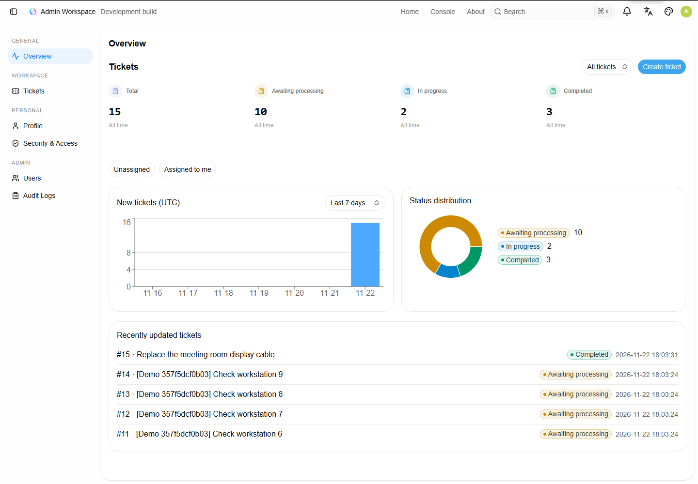
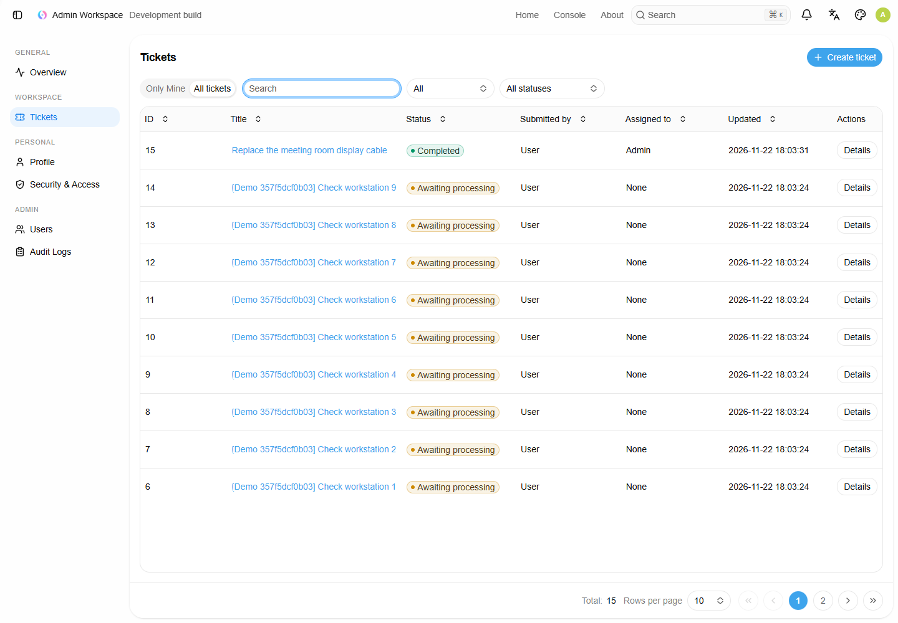
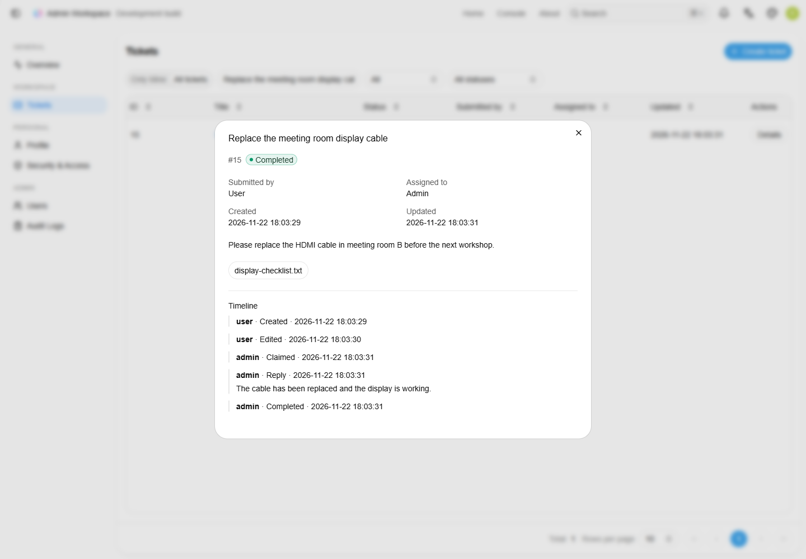
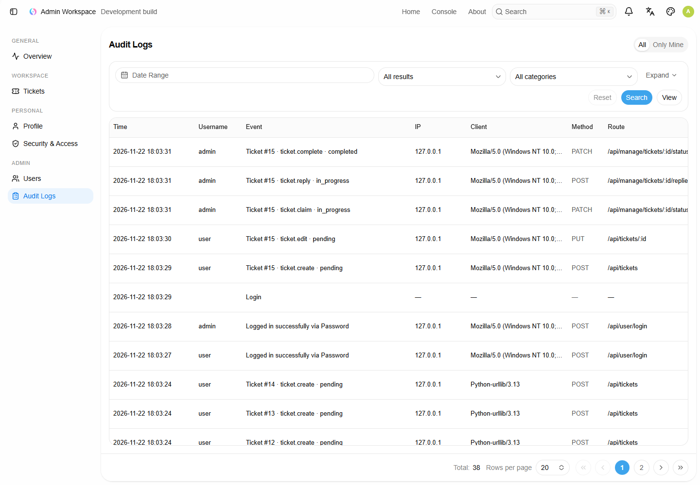
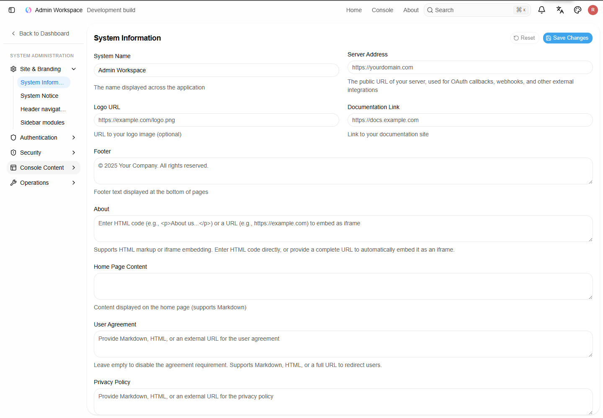

# New API · 通用管理后台

这是从 QuantumNous/new-api 改造的 Go、Gin、GORM 与 React 管理后台模板。默认安装包含可独立移除的工单示例。账号、权限、系统设置、审计和运维均有独立入口。项目范围与角色表见 [产品说明](docs/PRODUCT.md)，模块注册、数据边界见 [架构说明](docs/ARCHITECTURE.md)。

## 浏览模板

User 在工作台提交工单，并在个人页面管理账号安全和个人访问令牌。获得工单授权的 Admin 可处理工单，在「管理员 → 审计日志」查阅审计。Root 管理全局权限、站点设置和运维。移除示例后，账号、审计、设置及运维仍可独立运行。

以下五张图取自同一个全新 SQLite 演示实例，使用 Edge 登录不同角色后截取。

| 概览：状态分布与最近更新 | 工单列表：范围、筛选与负责人 |
| --- | --- |
|  |  |
| **工单详情：附件、回复及完成记录** | **管理员审计：操作和结果** |
|  |  |

<details><summary>Root 的站点设置</summary>



</details>

## 获取源码

默认分支 `main` 包含底座与工单示例。克隆仓库即可开发；发布版本可在 GitHub Releases 下载完整源码或应用源码包。

```bash
git clone https://github.com/Im-oldxu/new-api.git
cd new-api
```

## 全新安装

以下命令使用 Linux Bash，从仓库根目录执行。请先准备 Git、Go 1.26.10、Bun 1.4.4、Node.js 22 和 Python 3.11 或更高版本。Web 生产构建完成后，Go 将静态资源嵌入服务端程序。

```bash
(
  set -eu
  build_version=v0.0.0
  file_version=$(cat VERSION)
  if [[ ! -e .git ]]; then
    build_version=$file_version
  elif [[ -z "$(git status --porcelain)" ]] && git tag --points-at HEAD | grep -Fxq -- "$file_version"; then
    build_version=$file_version
  fi
  export VITE_RELEASE_REPOSITORY=Im-oldxu/new-api
  (cd web && bun install --frozen-lockfile && bun run build)
  mkdir -p build
  GOWORK=off go build -mod=readonly -ldflags "-X github.com/Im-oldxu/new-api/common.Version=$build_version" -o build/admin-server .
  ./build/admin-server --version
)
```

首次启动使用新的同级目录 `../admin-run`，在该目录生成仅当前用户可读写的配置。已有实例直接使用下方重启命令。

```bash
(
  set -eu
  umask 077
  server="$PWD/build/admin-server"
  mkdir -m 700 ../admin-run
  cp .env.example ../admin-run/.env
  cd ../admin-run
  python3 - <<'PY'
from pathlib import Path
import secrets

with Path(".env").open("a", encoding="utf-8") as config:
    print("\nHOST=127.0.0.1", "PORT=23100", "SQLITE_PATH=admin.db",
          "SESSION_SECRET=" + secrets.token_hex(32),
          "CRYPTO_SECRET=" + secrets.token_hex(32), sep="\n", file=config)
PY
  exec "$server"
)
```

打开 http://127.0.0.1:23100 并按初始化页面创建 Root。也可以在尚未初始化的本地演示实例上执行下节的导入命令，由脚本通过安装 API 创建 Root。主节点负责建表，SQLite 使用运行目录中的 admin.db。MySQL 与 PostgreSQL 可通过 SQL_DSN 配置独立空数据库。独立审计库使用 LOG_SQL_DSN。前台按 Ctrl+C 停止。从仓库根目录再次启动时执行 `(server="$PWD/build/admin-server"; cd ../admin-run && exec "$server")`，继续使用原数据库和密钥。

## Docker Compose 安装

在新目录的仓库根部使用 Docker Engine 和 Compose v2 或更高版本。默认配方从当前工作树编译 Web、Go 并生成本地镜像 `new-api-admin:local`，同时启动 PostgreSQL 15 和 Redis。以下命令为首次安装生成四个独立的随机值，遇到已有 `.env` 会停止。旧安装请沿用现有凭据。请将此文件保存在当前部署的私有目录中。

```bash
(
  set -eu
  umask 077
  python3 - <<'PY'
from pathlib import Path
import secrets

with Path(".env").open("x", encoding="utf-8") as config:
    for key in ("POSTGRES_PASSWORD", "REDIS_PASSWORD", "SESSION_SECRET", "CRYPTO_SECRET"):
        print(f"{key}={secrets.token_hex(32)}", file=config)
PY
)
```

配置就绪后，从同一目录启动。

```bash
docker compose config --quiet
docker compose up -d --build --wait
docker compose ps
docker compose logs --tail 50 new-api
```

打开 [本机站点](http://127.0.0.1:3000)，按安装页创建 Root。访问 [健康接口](http://127.0.0.1:3000/api/status) 应返回 `success: true`。需要演示数据时，在下面的导入命令中将 URL 改为本实例地址。SQLite 离线批次清理仅适用于 SQLite 演示库。

| 配置位置 | 用途及生效方式 |
| --- | --- |
| 根目录 `.env` 的 `ADMIN_HTTP_PORT` | 修改宿主回环端口，默认 3000。再次运行 Compose 更新端口映射。PostgreSQL 和 Redis 仅位于项目网络。 |
| 构建参数 `APP_VERSION`、`VITE_RELEASE_REPOSITORY` | 默认从根 `VERSION` 取构建版本，空文件产生开发版。发布构建可传已核实的标签。Compose 默认查询 `Im-oldxu/new-api`，可填写自己的公开 `owner/repository`，显式留空关闭检查。开发镜像需要显示开发版时设置 `APP_VERSION=v0.0.0`。修改后用 `docker compose up -d --build --wait`。 |
| 构建参数 `GOPROXY` | Go 公共代理不可达时可通过 Compose 的环境指定可达的模块代理；构建使用仓库的 go.sum 校验依赖。 |
| 两个数据库密码、会话及加密密钥 | Compose 由环境或根 `.env` 传入容器。默认 Compose 使用镜像的内嵌版本。原生运行的变量见下文。旧 PostgreSQL 卷沿用初始化时的密码，修改 .env 不会自动修改数据库账户密码。 |

应用数据和日志分别绑定到 `./data` 和 `./logs`。PostgreSQL 使用 Compose 项目的 `pg_data` 卷。升级时沿用原工作目录、Compose 项目名、密钥和密码。需要隔离另一份安装时使用新的目录、项目名（`docker compose -p <名称>`）和端口。用 `docker compose down` 停止，保留卷；再次启动后使用原账号登录。开发配方 `docker-compose.dev.yml` 单独构建后端并使用开发卷，可配合 Web 热更新；老开发卷需填写其原数据库密码。

## 演示

在另一个终端从代码根目录运行。选择当前用户私有目录中的凭据文件。

```bash
umask 077
python3 examples/tickets/demo.py --url http://127.0.0.1:23100 --credentials ../admin-run/demo-accounts.json
```

导入程序通过现有接口建号，使用 Root 密码二次验证创建管理员并授予工单读取和处理权限。生成的随机密码保存在指定文件。再次运行时复用该文件及已有演示工单。

| 角色 | 账号 | 操作路径 |
| --- | --- | --- |
| User | user | 工作台 → 工单 → 创建工单。填写标题、说明，可附一个不超过当前工单附件上限的文件。打开待处理工单可编辑，详情中可下载附件。 |
| Admin | admin | 工单 → 全部工单 → 详情 → 认领工单 → 发送回复 → 完成工单。演示管理员仅获得工单管理授权；可在管理员分组读取全站脱敏审计，系统设置由 Root 管理。 |
| Root | root | 用户管理中修改管理员权限，工单中查看全局记录，管理员 → 审计日志中检查操作。系统设置与系统信息提供独立管理入口。 |

导入创建 14 张带同一批次标签的工单。普通用户可以用标题搜索、状态筛选或翻页找到自己的样本。管理员与 Root 各有已认领的样本。已完成工单的回复和附件仍可查看。个人或管理详情仅展示工单参与者可见的活动，完整操作事件从「管理员 → 审计日志」查阅。

导入清单保存在所选凭据文件旁，后缀为 `.tickets.json`。要清理该批次，请停止独立 SQLite 演示服务，使用同一个 URL、凭据文件及演示数据库路径，再运行 `python3 examples/tickets/demo.py --url http://127.0.0.1:23100 --credentials ../admin-run/demo-accounts.json --cleanup-sqlite ../admin-run/admin.db`。清理程序逐项核对批次、编号、提交人、创建时间、标题及版本，仅清理匹配的样本及其处理记录。导入后已有新回复或修改的样本、其他工单、账号和审计记录均保留。无需清理时可直接复用原库。

概览以 UTC 自然日统计最近 7 或 30 天创建的工单。数字卡片和状态分布使用当前状态及全部时间。普通用户看到自己提交的工单，具备工单读取权限的管理员和 Root 可切换到相应管理列表；“由我处理”只列出本人认领且处理中的工单。点击最近更新记录打开详情。

用 Root 在工单页打开“工单设置”可设置每个附件的上限，支持 1 到 1024 KiB，初始为 1024 KiB。保存后新上传采用新的限制。此设置和概览随示例一起移除。

开发时在 web 下运行 `bun run dev --host 127.0.0.1 --port 25173`。先把环境变量 VITE_REACT_APP_SERVER_URL 指向正在运行的后端，例如 http://127.0.0.1:23100。浏览器使用前端地址，API 经开发代理转发。

## 运行版本与发布源

**当前版本**由后端 `common.Version` 提供。启动时 `main.go` 的 `InitResources` 先从**进程工作目录**加载 `.env`，再调用 `common.InitEnv()`。有效版本按以下顺序取值。

1. 进程里非空的 `VERSION`。启动器已设置的变量优先于文件，显式设置为空时也会阻止 dotenv 注入同名值。
2. 运行目录 `.env` 中非空的 `VERSION`。
3. 构建时通过 Go 链接参数写入的 `github.com/Im-oldxu/new-api/common.Version`，源码默认值在 `common/constants.go`，为 `v0.0.0`。

顶部品牌、管理员更新入口和「系统设置 → 运维 → 系统维护」均读取 `GET /api/status` 的 `data.version`。前端把 `v0.0.0` 或 `0.0.0` 显示为“开发版”。后端进程重启后刷新页面即可核对。根目录 `VERSION` 文本文件供 Docker 构建读取；原生 `go build .` 不会自动读取它。部分打包脚本传给 Web 的 `VITE_REACT_APP_VERSION` 属于前端构建元数据，页面显示的运行版本由后端提供。

**发布源**使用 Web 编译变量 `VITE_RELEASE_REPOSITORY`，格式为公开 GitHub 仓库的 `owner/repository`，不含协议、域名、标签、`.git` 后缀或令牌。在 `web/.env.local` 持久配置，示例文件为 `web/.env.example`。也可以在启动 Bash 中用 `export` 设置。前端开发服务启动或生产构建时由 `web/rsbuild.config.ts` 读取并写入 JS。Root 的设置页只展示状态。本模板发布仓库为 `Im-oldxu/new-api`。复制后填自己的公开仓库，或显式留空关闭检查。浏览器匿名查询 GitHub，无法读取私有 Release；访问令牌不得放进前端变量。

Rsbuild 从 `web/` 按 `.env`、`.env.local`、`.env.<mode>`、`.env.<mode>.local` 的顺序加载，后面的文件覆盖前面的文件，启动进程已有的值优先。常用模式为 `development` 和 `production`。后端运行目录的 `.env` 与这组文件分开。一次性配置开发服务可在项目根目录执行以下 Bash 命令。

```bash
(
  cd web || exit 1
  export VITE_RELEASE_REPOSITORY=Im-oldxu/new-api
  export VITE_REACT_APP_SERVER_URL=http://127.0.0.1:23100
  bun run dev --host 127.0.0.1 --port 25173
)
```

此命令用于启动自己的前端实例。本机长期预览使用同一个 `web/`，改 `web/.env.local` 后重启其开发服务即可。生产站点需要重新构建 Web，然后重新构建嵌入了 `web/dist` 的 Go 服务，部署并重启。Docker 构建可传入 `docker build --build-arg VITE_RELEASE_REPOSITORY=Im-oldxu/new-api -t new-api-admin:local .`。

正式源码附件的原生构建步骤见上文“全新安装”。从开发工作树运行时，只有干净且匹配 VERSION 的正式标签才写入发布版本。请清除原生运行目录和启动器中的旧 VERSION 覆盖值。

**核对运行结果**可在新终端执行 `curl -fsS http://127.0.0.1:23100/api/status | python3 -c 'import json, sys; print(json.load(sys.stdin)["data"]["version"])'`。以 Root 打开系统维护，在浏览器开发者工具的网络面板筛选 `api.github.com`。已配置时，检查请求为 `GET https://api.github.com/repos/<owner>/<repository>/releases?per_page=100`，只读公开发布记录，并按可解析版本筛选。浏览器按仓库缓存最近检查，首次验证可用新的浏览器会话，也可在更新对话框中手动检查。未配置时显示“未配置发布源”，检查按钮禁用，没有 releases 请求。真实发布联调还需在该仓库发布可识别的版本标签并核对详情链接。

## 复制模板与移除示例

在原 Git 工作区运行 `python3 scripts/export_template.py ../my-admin`，目标须为新目录。脚本使用当前工作树的源码、锁文件、前端静态资源和配置示例。数据库、运行日志、账号文件、本机密钥、用户上传和依赖安装目录均不参与导出。应用文件已包含在导出目录中，可为新业务初始化自己的 Git 仓库。安装步骤与上文相同。保留许可证、NOTICE、第三方许可及界面中的上游署名。

从交付 ZIP 开始时，直接解压到新目录并从“全新安装”开始。每个项目单独创建运行目录、数据库和密钥。Root 进入「系统设置 → 站点 → 系统信息」保存新的站点名称，此名称由本安装的 `SystemName` 配置提供。演示账号和批次清单属于各自实例。维护库中的独立 Go 工具包、Electron、CI 和历史进度记录保留在原仓库，运行模板使用根 Go 模块和 web/bun.lock。

在导出的副本中运行 `python3 scripts/remove_ticket_example.py` 检查涉及的文件。应用删除时追加 `--apply`。随后从 web 运行 `bun run build` 重新生成前端路由，再从根目录重新执行 Go 构建。该脚本同时移除工单概览注册、统计 API、业务设置和三张示例表的迁移。新的空数据库只安装底座表；已有数据库继续保留其工单与历史附件。

## 开发新业务

1. 参照 `examples/tickets/tickets.go` 定义业务实体、表名、迁移函数及 API 注册函数。在根目录添加与 `tickets_example.go` 同级的组合文件，向 `router/main.go` 定义的 BusinessModule 注册 Migrate、Register。主节点执行迁移。
2. 在服务端按已验证身份限定查询和更新范围。管理操作用 authz.RegisterResource 声明权限，受限令牌路由声明对应 scope。个人会话专用接口通过 DeclareSessionRoute 注册。
3. 前端在 `web/src/features/` 实现页面，在 `web/src/routes/_authenticated/` 注册路由。分别通过 `web/src/business-navigation.ts` 和 `web/src/business-overview.ts` 注册菜单、概览。示例专属设置在 `examples/tickets/overview.go` 和 `web/src/features/tickets/settings.tsx`，由模块迁移和授权。复用共享表格、表单、弹窗、翻译和 API 客户端。
4. 运行 Go 测试、三库新装与升级检查，并在 web 下执行 typecheck、lint、test 和 build。检查跨账号访问、状态冲突、数据重启与审计。业务演示数据使用独立显式导入步骤。

**复用状态标签。** 在新业务自己的目录维护“状态值 → 翻译键、语义颜色”映射。参照 `web/src/features/tickets/api.ts` 和 `ticket-status-badge.tsx`，向共享 `StatusBadge` 传入翻译后的 `label`、对应的 `variant` 和 `copyable={false}`。主题提供 `warning`、`info`、`success` 等语义色，图例与图表扇区从同一映射取色。办理顺序若有独立规则，应由业务单独定义。

## 账号安全和外部服务

在系统设置中为本安装配置邮件服务器或 Resend，通过独立测试邮箱验收注册邮件、绑定和找回密码。OAuth/OIDC 需要提供方客户端凭据及与本机或 HTTPS 站点匹配的回调地址。配置后分别验证授权、回调、绑定、解绑和拒绝授权。Passkey 使用可用的安全源和匹配的 RP ID，2FA 使用验证器并保管恢复码。查看 [认证说明](docs/authentication.md) 了解会话、刷新与撤销行为。

## 验证范围与维护文档

原生 SQLite 和 Docker Compose 的工单流程通过真实浏览器验证。设置页的开关、重启持久化、本地 SMTP、本机 OAuth 替身和虚拟 WebAuthn 凭据已有独立验证。正式 OAuth、硬件 Passkey、Turnstile、公网邮件、外部 Webhook、Uptime Kuma、实际部署旧库和 ClickHouse 需要在接入环境验证。演示模式只控制站点展示；注册仍受注册开关控制。部分设置页逐项保存，后项失败时前面成功的配置可能已经生效，重新加载核对后再重试。

产品及设置验收见 [PRODUCT](docs/PRODUCT.md)。扩展与兼容要求见 [ARCHITECTURE](docs/ARCHITECTURE.md)。后续工作见 [TASKS](docs/TASKS.md)，当前证据范围见 [交接记录](docs/session-handoff.md)，用户可感知的变化见 [CHANGELOG](docs/CHANGELOG.md)。

## 维护 CHANGELOG 和发布版本

日常开发将已经验证、对用户可见的变化合并到 `docs/CHANGELOG.md` 的 `## [Unreleased]`。发布前将当期条目移入唯一的 `## [X.Y.Z] - YYYY-MM-DD`，保留顶部 Unreleased，根目录 VERSION 填写同一个 `vX.Y.Z`。如果发布日期改变，在创建 tag 前更新日期。外部联调范围见 PRODUCT 和交接记录。

从完整仓库根目录执行以下 Bash 命令。先复核所有修改和新增文件，再提交代码、版本文件及正式版本章节。

```bash
(
  set -eu
  tag=$(cat VERSION)
  notes=$(mktemp)
  trap 'rm -f -- "$notes"' EXIT
  python3 -m unittest discover -s scripts -p 'test_release*.py'
  python3 scripts/release_notes.py "$tag" "$notes"
  cat "$notes"
)
git status --short --branch --untracked-files=all
```

核对上述检查结果与文件清单后，暂存改动，并审阅最终差异。

```bash
git add -A -- .
git diff --cached --check && git diff --cached --stat
```

确认暂存内容后提交并推送。

```bash
git commit -m "release: prepare $(cat VERSION)" && git push -u origin main
```

在 GitHub 检查默认分支和 CI 结果。已有受保护 main 的仓库可将提交推到审查分支（例如 `git push origin HEAD:refs/heads/release-template`），按仓库规则开 PR 并合并，再拉取合并后的 main。若远端有独立提交，先获取并审阅历史。完成分支检查后，在包含正式版本章节和代码的远端 main 提交上创建单个附注 tag。

```bash
(
  set -eu
  tag=$(cat VERSION)
  git fetch origin main
  commit=$(git rev-parse refs/remotes/origin/main)
  [[ "$(git show "${commit}:VERSION")" == "$tag" ]] || { echo "远端 VERSION 与待发布 tag 不一致" >&2; exit 1; }
  git show --stat --oneline "$commit"
  existing=$(git ls-remote --tags origin "refs/tags/$tag")
  [[ -z "$existing" ]] || { echo "远端 tag 已存在" >&2; exit 1; }
  git tag -a "$tag" "$commit" -m "Release $tag"
  git push origin "refs/tags/$tag"
)
```

分支推送和 PR 执行 Web 类型、Lint、测试、生产构建和 Go 主模块及两个独立模块的检查。推送版本 tag 后，Actions 对同一提交重新检查，验证 VERSION 与正式章节，并生成应用源码 ZIP 和 SHA256SUMS。发布任务确认远端 tag 提交、创建草稿、上传并读回两个附件，最后公开。完整仓库源码由 GitHub 自动归档。仓库需启用 Actions 并允许发布任务的 GITHUB_TOKEN 获取 contents: write；普通检查仅使用 contents: read。无需 PAT、镜像仓库或 Actions 发布源变量。仓库或组织限制第三方 Action 时需放行 CI 中固定版本的 Bun 设置 Action。

同一 tag 的发布任务串行执行。网络中断可在 Actions 对原运行选择 **Re-run failed jobs**。流程核对已有正文与附件，只补缺失的草稿附件。若草稿中存在错误附件，核对证据后人工移除草稿中的错误文件再重试。已公开 Release 仅做核验，制品或内容需要变更时使用新版本。保留已发布的 tag。

首次发布后，在仓库根目录使用已登录的 GitHub CLI 核对 Release，再下载到新建的临时目录并校验附件。

```bash
(
  set -eu
  tag=$(cat VERSION)
  gh release view "$tag" --repo Im-oldxu/new-api --json name,body,isDraft,assets
  download_dir=$(mktemp -d)
  cd "$download_dir"
  gh release download "$tag" --repo Im-oldxu/new-api
  sha256sum -c SHA256SUMS
  echo "附件目录：$download_dir"
)
```

解压后按“全新安装”启动，核对 `/api/status` 的版本和维护页更新链接。另行克隆默认分支可核对底座与工单源码。

## 许可证与上游

项目使用 GNU Affero General Public License v3.0 及附加署名条款。原始项目为 [QuantumNous/new-api](https://github.com/QuantumNous/new-api)，基于 [One API](https://github.com/songquanpeng/one-api)。界面保留上游项目链接及署名 “Frontend design and development by New API contributors.”。详见 [LICENSE](LICENSE)、[NOTICE](NOTICE) 和 [第三方许可](THIRD-PARTY-LICENSES.md)。
